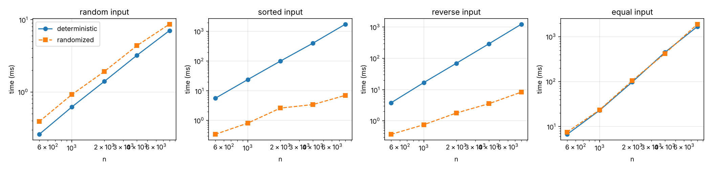

# Assignment 5: Quicksort Implementation, Analysis, and Randomization

## 1. Overview

Quicksort is a divide and conquer sorting algorithm. It picks a pivot, partitions the array around it, and sorts the two parts recursively. This report covers two versions. The deterministic version uses the last element as the pivot. The randomized version uses a random element. Both are in `quicksort.py`.

## 2. Implementation

Both versions sort in place. They share one partition function based on the Lomuto scheme (Cormen et al., 2022).

```python
def partition(arr, low, high, stats=None):
    pivot = arr[high]
    i = low - 1
    for j in range(low, high):
        if arr[j] <= pivot:
            i += 1
            arr[i], arr[j] = arr[j], arr[i]
    arr[i + 1], arr[high] = arr[high], arr[i + 1]
    return i + 1
```

The partition loop makes exactly `high - low` comparisons. After it runs, the pivot is in its final position. Smaller or equal elements are on its left, and larger ones are on its right.

The randomized version adds one step before partitioning. It swaps a random element into the pivot position.

```python
r = rng.randint(low, high)
arr[r], arr[high] = arr[high], arr[r]
p = partition(arr, low, high, stats)
```

A `Stats` object can count comparisons and track recursion depth. This lets the analysis compare theory with measured counts. The tests in `tests/test_quicksort.py` check empty, single, sorted, reverse, equal, duplicate, negative, and random inputs. All 9 tests pass.

## 3. Time Complexity

Let T(n) be the running time on n elements. Partitioning takes Θ(n). If the pivot ends at position k, then T(n) = T(k) + T(n - k - 1) + Θ(n).

**Best case: Θ(n log n).** The pivot always lands in the middle. Then T(n) = 2T(n/2) + Θ(n). By the master method, T(n) = Θ(n log n).

**Worst case: Θ(n²).** The pivot is always the smallest or largest element. One side is empty, so T(n) = T(n - 1) + Θ(n). This sums to n + (n - 1) + ... + 1, which is Θ(n²). With a last element pivot, this happens on sorted and reverse sorted input.

**Average case: Θ(n log n).** Suppose every split is equally likely. Even an uneven split such as 9 to 1 gives T(n) = T(9n/10) + T(n/10) + Θ(n). The recursion tree has depth O(log n), and each level costs O(n). So the total is O(n log n). Bad splits are rare, and good and bad splits mix, so the average stays close to the best case.

## 4. Space Complexity

Quicksort sorts in place. It needs no extra array. Its extra space is the recursion stack. In the best and average cases the depth is O(log n). In the worst case the depth is O(n). The benchmark confirms this. On sorted input of 8000 elements, the deterministic version reached depth 7999. A common fix is to recurse on the smaller part first and loop on the larger part. That limits the stack to O(log n) in every case.

## 5. Randomized Quicksort

Randomization removes the link between the input order and the pivot. No fixed input is bad for it. Sorted input is no worse than any other input.

The expected running time is O(n log n) on every input. A short argument shows why. Let the sorted elements be z1 to zn. Elements zi and zj are compared only if one of them is the first pivot chosen from the range zi to zj. That range has j - i + 1 elements, so the probability is 2 / (j - i + 1). Summing over all pairs gives the sum of 2 / (j - i + 1) across all i < j. This is O(n log n) (Cormen et al., 2022).

The worst case is still possible, but it needs a very unlucky series of random picks. Its probability falls quickly as n grows.

## 6. Empirical Analysis

The benchmark in `benchmark.py` sorts four kinds of input at five sizes (500 to 8000). It records the best of three run times, the number of comparisons, and the recursion depth. Full results are in `results.csv`, and charts are in `results.png`.

Results for n = 8000:

| Input | Version | Time (ms) | Comparisons | Depth |
|---|---|---|---|---|
| Random | Deterministic | 7.04 | 122,545 | 29 |
| Random | Randomized | 8.64 | 115,387 | 26 |
| Sorted | Deterministic | 1750.09 | 31,996,000 | 7999 |
| Sorted | Randomized | 7.00 | 118,648 | 32 |
| Reverse | Deterministic | 1241.88 | 31,996,000 | 7999 |
| Reverse | Randomized | 8.31 | 119,361 | 29 |
| All equal | Deterministic | 1682.18 | 31,996,000 | 7999 |
| All equal | Randomized | 1902.01 | 31,996,000 | 7999 |



## 7. Discussion

**The results match the theory.** On sorted and reverse sorted input, the deterministic version made exactly n(n - 1)/2 comparisons, which is 31,996,000 for n = 8000. Its time grew about four times each time n doubled. That is the Θ(n²) pattern. The randomized version made about 119,000 comparisons on the same input. For comparison, n log2 n is about 103,700 for n = 8000. Its time grew a little more than twice each time n doubled.

**Random input shows a small cost for randomization.** On random input both versions are fast, and the deterministic one is about 20 percent faster. The randomized version calls the random number generator at every partition. This extra work has no benefit when the input is already in random order. Comparison counts were nearly the same.

**Equal elements break both versions.** With all elements equal, every element is less than or equal to the pivot. The partition puts everything on one side, so both versions are quadratic. Randomization cannot help because every pivot is the same value. A three way partition, which groups elements equal to the pivot, would fix this. It was not required here, but it is a useful improvement.

**Python adds overhead.** Absolute times are larger than they would be in a compiled language. The recursion limit also had to be raised, because the worst case recurses n levels deep. This is another reason to avoid worst case inputs.

## 8. Conclusion

Quicksort is fast on average, but a fixed pivot rule can fail on common inputs such as sorted data. Random pivot selection gives O(n log n) expected time on every input, at a small cost on random data. Inputs with many equal keys need a different fix, such as three way partitioning.

## Reference

Cormen, T. H., Leiserson, C. E., Rivest, R. L., & Stein, C. (2022). *Introduction to algorithms* (4th ed.). MIT Press.
